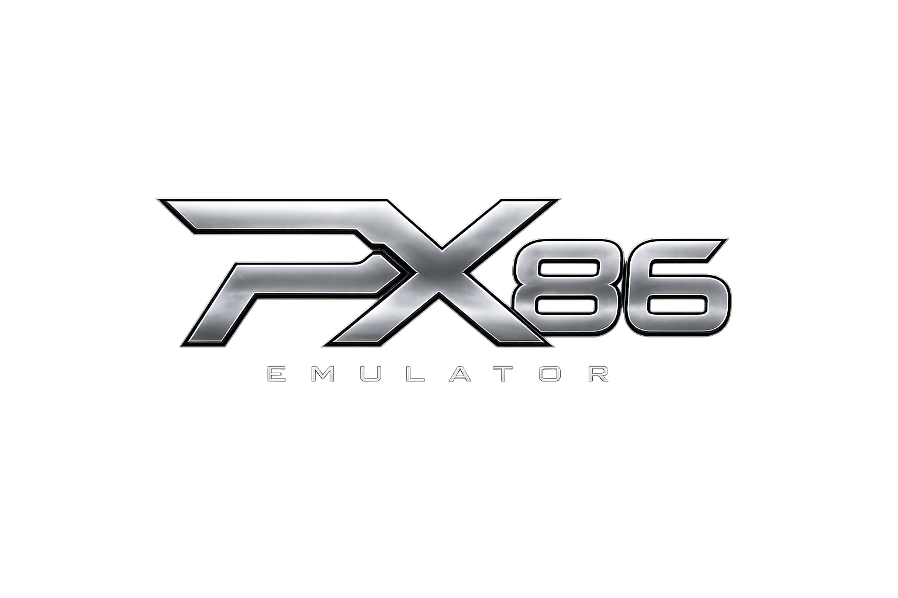

<p align="center">
  
</p>

<p align="center">
  A Nintendo DS emulator written in C# (.NET 8), with a debugger and remote-control server built for reverse engineering.
</p>

---

PX86 emulates both DS CPUs, the 2D and 3D graphics engines, sound, wireless and the cartridge, and runs on Windows, Linux and macOS. It direct-boots games with a built-in HLE BIOS, so **no BIOS or firmware dumps are needed**. It is also the emulator behind [CodeDesigner NDS](https://github.com/FatalityDevelopment/CodeDesignerNDS), which drives it over a local socket to debug and patch games from VS Code.

## Features

| Area | What you get |
|---|---|
| **CPUs** | ARM946E-S (ARMv5TE) and ARM7TDMI (ARMv4T) interpreters, plus an IL JIT for hot blocks (about 2x the interpreter). The interpreter and JIT give identical results. |
| **Graphics** | All 2D background modes, sprites, windows, blending and display capture. A 3D engine with geometry, clipping, lighting, every texture format and a software rasterizer. |
| **Sound** | 16 channels of PCM, ADPCM, PSG and noise, with capture, played through OpenAL. |
| **Hardware** | Memory system and banking, interrupts, timers, DMA, IPC, hardware maths, RTC, and the SPI devices (firmware, touch screen, power manager). |
| **Cartridge** | Slot protocol with save-chip auto-detection (EEPROM, FLASH, FRAM). Saves are written to `<game>.sav`. |
| **Wireless** | Local play between emulator windows (trades, battles, Download Play), or online through a built-in access point and NAT with a replacement WFC DNS server. |
| **Microphone** | The PC microphone feeds the DS mic, or hold a key to blow. |
| **Save states** | Ten slots per game. |
| **Cheats** | Action Replay DS codes (the full opcode set), raw codes, a memory search, and import from `usrcheat.dat`. |
| **Debugging** | ARM9/ARM7 debugger with breakpoints and watchpoints, hex editor, I/O register view, palette/tile/OAM/3D viewers, string dumper, execution tracker, printf/sprintf hooks and a game output log. |
| **Remote control** | A headless mode with a PINE socket (memory, registers, stepping, input, save states) and a live frame stream. |
| **Frontend** | Silk.NET window with SDL, OpenGL and Dear ImGui menus; keyboard and gamepad input, mouse as stylus, fast-forward, fullscreen and screenshots. |

Implementation status by subsystem is in [docs/roadmap.md](docs/roadmap.md). Real BIOS/firmware boot is implemented but untested, because it needs your own dumps. The compatibility list is still empty.

## Quick start

You need the [.NET 8 SDK](https://dotnet.microsoft.com/download). The SDL2 and OpenAL libraries come through NuGet.

```bash
git clone https://github.com/FatalityDevelopment/PX86-NintendoDS.git
cd PX86-NintendoDS

dotnet build Px86.NintendoDS.sln -c Release
dotnet run --project Px86.NintendoDS.Emulator -c Release -- "path/to/game.nds"
```

Start it without a ROM to open one with **File → Open ROM** (Ctrl+O), or drag a `.nds` file onto the window. To run the tests:

```bash
dotnet test Px86.NintendoDS.TestProject
```

## Controls

| DS | Keyboard |
|---|---|
| D-pad | Arrow keys |
| A / B / X / Y | X / Z / S / A |
| L / R | Q / W |
| Start / Select | Enter / Backspace |
| Touch screen | Left mouse button on the bottom screen |

Gamepads work too. Hotkeys include Tab for fast-forward, F5/F8 to save and load a state, F11 for fullscreen and F12 for a screenshot. Every binding can be changed in **Config → Settings → Input**. The full list is in the [emulator guide](docs/emulator.md#controls).

## Debugging and remote control

The **Tools** menu has the debugger (Ctrl+D), memory editor (Ctrl+M), log (Ctrl+L), string dumper (Ctrl+T), cheats (Ctrl+C) and the video viewers. The [emulator guide](docs/emulator.md#debugging) covers each one.

To drive the emulator from another program, run it headless:

```bash
Px86.NintendoDS.Emulator game.nds --headless                  # PINE on 28013, frame stream on 28014
Px86.NintendoDS.Emulator game.nds --headless --paused         # set breakpoints first, then resume
Px86.NintendoDS.Emulator game.nds --headless --frames 600 --screenshot out.png
```

Both sockets listen on the loopback interface only. The wire format and every opcode are described in [docs/pine-protocol.md](docs/pine-protocol.md).

## Repository layout

| Project | Purpose |
|---|---|
| `Px86.NintendoDS.Common` | ARM CPU interpreter, CP15, ARM and Thumb disassemblers and assemblers |
| `Px86.NintendoDS.FileFormats` | `.nds` header and NitroFS, CRC16, PNG and JPEG writers |
| `Px86.NintendoDS.EmulatorCore` | The console: buses, hardware, video, audio, cartridge, HLE BIOS, JIT, debugging, remote sockets |
| `Px86.NintendoDS.Emulator` | The desktop frontend and headless runner |
| `Px86.NintendoDS.TestProject` | MSTest suite: CPU, hardware, video, remote, debugging and frontend tests, plus test-ROM integration tests |
| `tools/testroms` | A clang toolchain that builds the test ROMs from C sources in this repo |

## Documentation

| Page | What it covers |
|---|---|
| [Emulator guide](docs/emulator.md) | Running games, controls, BIOS and firmware, saves, settings, cheats, debugging, wireless |
| [Building](docs/building.md) | Prerequisites, tests, test ROMs, CI |
| [Remote control](docs/pine-protocol.md) | The PINE opcodes and the frame stream |
| [Architecture](docs/ARCHITECTURE.md) | How the projects fit together, the main loop, the JIT |
| [Hardware reference](docs/hardware-reference.md) | DS memory map and register cheat sheet |
| [Learning resources](docs/learning-resources.md) | GBATEK and other emulators worth reading |
| [Roadmap](docs/roadmap.md) | Status by subsystem and compatibility notes |

## Legal

Play only games you own. ROMs, BIOS dumps, firmware dumps and save files are not included and must never be committed. PX86 is written from the public GBATEK documentation; the GPL emulators it learns from are read for behaviour, not copied.
